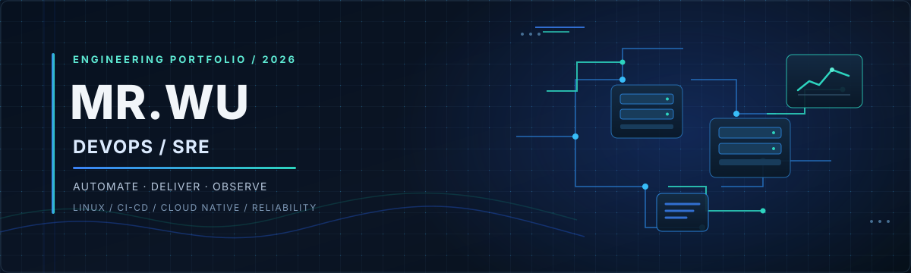

  

### IT Operations → DevOps / SRE

**Automation · Continuous Delivery · Cloud-Native Operations · Reliability**

---

## About

I'm an IT operations professional with **8+ years of experience in technical support and infrastructure operations**, building a project-based portfolio focused on **DevOps, CI/CD, cloud-native operations, and Site Reliability Engineering (SRE)**.

My approach is outcome-driven: learn a concept, apply it in a lab or project, document the implementation, and validate the result. I’m particularly interested in making systems easier to deploy, observe, troubleshoot, and maintain.

- **Career direction:** DevOps / CI/CD engineering
- **Automation:** Python and shell scripting
- **Engineering practices:** reproducible setup, version control, testing, documentation, monitoring, and iterative improvement
- **Portfolio objective:** demonstrate practical engineering through working projects and clear technical write-ups

## Current Focus

  
  
  
  
  
  
  
  

These badges describe my current learning and project focus; they are not a claim of expert-level proficiency in every tool.

## Selected Public Projects

<table>
  <tr>
    <td width="50%" valign="top">
      <h3><a href="https://github.com/1314176/SRE-Learning">SRE-Learning</a></h3>
      
A structured learning and lab repository documenting my DevOps/SRE transition.

      
<strong>Focus:</strong> Linux · Shell · Git · Containers · CI/CD · Kubernetes · Monitoring

      <a href="https://github.com/1314176/SRE-Learning">Explore repository →</a>
    </td>
    <td width="50%" valign="top">
      <h3><a href="https://github.com/1314176/NearByCheckIn">NearbyCheckIn</a></h3>
      
An Android utility project exploring location-aware check-in workflows and background automation.

      
<strong>Focus:</strong> Android · Location workflows · Automation

      <a href="https://github.com/1314176/NearByCheckIn">Explore repository →</a>
    </td>
  </tr>
</table>

## Engineering Principles

<table>
  <tr>
    <td width="25%" valign="top">
      <strong>01 · Automate</strong> 
      Replace repetitive manual work with repeatable scripts and workflows.
    </td>
    <td width="25%" valign="top">
      <strong>02 · Deliver</strong> 
      Make build, test, and deployment steps explicit and reproducible.
    </td>
    <td width="25%" valign="top">
      <strong>03 · Observe</strong> 
      Use logs, metrics, and clear signals to understand system behavior.
    </td>
    <td width="25%" valign="top">
      <strong>04 · Improve</strong> 
      Troubleshoot from evidence, document fixes, and reduce repeat incidents.
    </td>
  </tr>
</table>

## Roadmap

- [ ] Strengthen Linux administration, networking, and shell automation
- [ ] Build repeatable CI pipelines with GitHub Actions and Jenkins
- [ ] Containerize applications with Docker and practice Kubernetes deployments
- [ ] Automate configuration and environment setup with Ansible
- [ ] Add metrics, dashboards, and alerting with Prometheus and Grafana
- [ ] Publish end-to-end project documentation covering architecture, deployment, tests, and troubleshooting

## What I Value

- **Practical evidence over buzzwords**
- **Automation over repetitive manual steps**
- **Observability over guesswork**
- **Documentation that helps others reproduce the result**
- **Small, testable improvements over fragile one-off fixes**

## Connect

- GitHub: [@1314176](https://github.com/1314176)
- Public repositories: [Browse all repositories](https://github.com/1314176?tab=repositories)

---

  Build deliberately. Automate repeatable work. Improve reliability.

